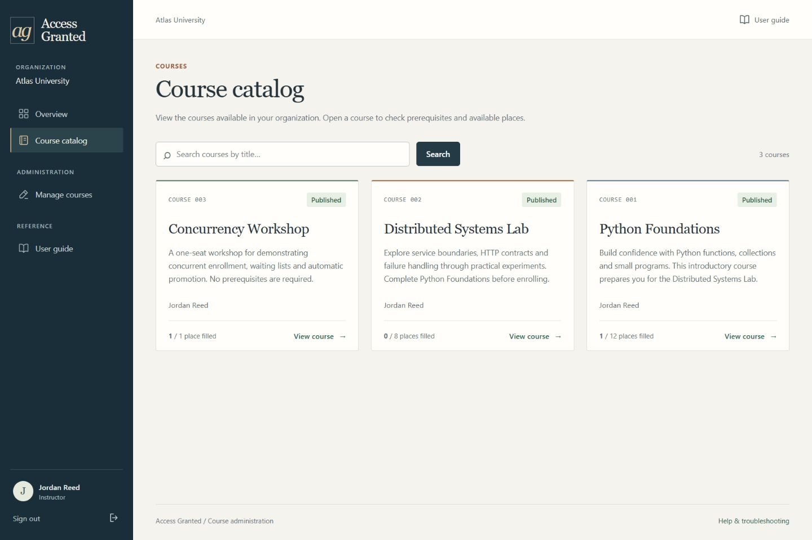

# Access Granted

A small multi-tenant course platform for a Distributed Systems Policies university project. Django enforces role-based and attribute-based access decisions from a separate FastAPI service. PostgreSQL transactions protect enrollment capacity and waitlist promotion.

All application text, demo courses and teaching materials are in English. This is a local teaching application with a deliberately small feature set.



## Understand the project

New to the codebase? Start with [How Access Granted works](docs/visual-guide.md), a visual guide with seven diagrams, examples and links to the implementation. It covers the containers, roles and pages, data model, authorization and audit, enrollment states, concurrent seat allocation and course lifecycle. The SVG images open on GitHub or locally; editable Mermaid sources are included.

For everyday use, follow the [User guide](docs/user-guide.md). For technical details, read the [architecture notes](docs/architecture.md) and [permission matrix](docs/permissions.md).

## Start from WSL

The project lives at `D:\An_2\PoSD\Proiect`, available inside WSL as `/mnt/d/An_2/PoSD/Proiect`.

```bash
bash /mnt/d/An_2/PoSD/Proiect/scripts/start.sh
```

Open [http://localhost:8000](http://localhost:8000). The first run builds images, generates local secrets, migrates PostgreSQL and seeds the demo. Later runs preserve records, uploaded files and changed passwords. No local Python environment is required.

After cloning or extracting the project into another folder, open that folder in WSL and run `bash scripts/start.sh`. Paths are resolved from the script's location.

Prerequisites: WSL 2 with Ubuntu, a running Docker Engine, Docker Compose v2, Docker Buildx, and internet for the first image build. For native Ubuntu Docker on Ubuntu 24.04, install missing plugins once with `sudo apt update && sudo apt install docker-compose-v2 docker-buildx`. Confirm the environment with `docker info`, `docker compose version` and `docker buildx version`.

## User documentation

Open **User guide** in the application navigation or go to [the in-app guide](http://localhost:8000/guide/). It explains every menu, role, form and course workflow, with troubleshooting and the current feature limits. Search its 24 sections, download the Markdown copy, or print the full guide from your browser. Help is also available from Sign In and does not require the policy service.

The same guide is included as [docs/user-guide.md](docs/user-guide.md), so teammates can read it without starting Docker. Its shared source is `data/user-guide.json`; after editing the content, regenerate the downloadable copy with `python3 scripts/export-guide.py`. Tests check that both copies stay in sync.

## Demo accounts

The initial password for all demo accounts is `LearnTogether2026!`, unless `DEMO_PASSWORD` was changed in `.env` before the first seed.

| Organization | Administrator | Instructor | Students |
|---|---|---|---|
| Atlas University | `atlas.admin` | `atlas.instructor` | `atlas.student1`, `atlas.student2`, `atlas.student3` |
| Nova Academy | `nova.admin` | `nova.instructor` | `nova.student1`, `nova.student2`, `nova.student3` |

The separate `superadmin` account uses [Django Admin](http://localhost:8000/admin/) for platform administration. Use organization accounts for the course application. Every organization account has exactly one organization and one role.

Student 1 in each organization has completed the introductory course. Student 2 is enrolled in it. Student 3 has no initial enrollments. One-seat workshops start empty so the enrollment and waitlist transitions can be demonstrated live.

## Daily commands

Run these from WSL:

```bash
cd /mnt/d/An_2/PoSD/Proiect
bash scripts/start.sh       # Build and start; preserves data
bash scripts/test.sh        # Policy tests, Django tests, system and migration checks
bash scripts/stop.sh        # Stop the stack; preserves named volumes
docker compose ps          # Container health
docker compose logs --tail=100 web policy
```

`start.sh` rebuilds the application images after source changes. Source code is copied into the images, not bind-mounted for automatic reload.

For an intentional fresh demonstration only:

```bash
bash scripts/reset-demo.sh
```

The reset script requires typing `RESET`. It removes all application records, sessions and private uploaded files, then restores the synthetic dataset. Save any changes you want to keep before resetting. It does not reset `.env`.

## What is included

- Organization isolation across pages, forms, users, audit records and downloads.
- Student, Instructor and Organization Administrator roles with explicit permissions.
- Course ownership, publication state and enrollment attributes in access decisions.
- Course and material management, including protected text lessons and PDFs.
- Prerequisites, capacity limits, FIFO waitlists, withdrawal and completion.
- Audit events for access decisions and important changes.
- English interface, local Bootstrap assets and responsive course pages.
- Two fictional organizations, 11 accounts, six courses and 18 materials.

Payments, public registration, email delivery, video processing and multi-region replication are outside this initial version. Final individual essays and the PowerPoint are a later team deliverable; outlines are included.

## Project map

| Location | Purpose |
|---|---|
| `config/` | Django settings and entry points |
| `learning/` | Models, forms, views, domain services and authorization client |
| `tests/` | Django integration, enrollment concurrency, form and seed tests |
| `policy_service/` | Stateless FastAPI policy evaluator, contract and tests |
| `templates/`, `static/` | English pages, local Bootstrap assets and application styles |
| `data/` | Original synthetic fixture and provenance |
| `scripts/`, `compose.yaml` | Start, stop, tests, reset and container configuration |
| `docs/` | Architecture, permissions, demo, presentation and essay preparation |

## Configuration and persistence

The startup script creates `.env` with independent random Django, database and policy-service secrets. `.env` is excluded from version control. To use a different local port, change `APP_PORT` in `.env` and run `start.sh` again. Only the web port is published, bound to `127.0.0.1`.

PostgreSQL data and private materials use Docker named volumes. `stop.sh` preserves them. Avoid `docker compose down --volumes` unless you intend to erase the data. Changing `POSTGRES_PASSWORD` in `.env` alone does not change the password in an already initialized database.

Demo initialization uses a versioned marker and a database transaction. Running `seed_demo` again leaves all existing records and passwords untouched. If the database contains user data without the marker, initialization stops rather than merging or overwriting it. Fixture edits affect a fresh/reset demo only.

## Troubleshooting

| Symptom | Check or action |
|---|---|
| Docker is unavailable | Start the selected WSL Docker daemon or Docker Desktop integration; run `docker info` |
| Compose command is missing | Install `docker-compose-v2` in the Ubuntu environment |
| Buildx is missing or an image build cannot start | Install `docker-buildx` for native Ubuntu Docker; verify with `docker buildx version` |
| Docker shows inconsistent containers or socket errors | Avoid running Docker Snap and native Docker against the same socket simultaneously. Check `docker context show`, `docker info` and the selected daemon; use one Docker installation consistently. Do not delete Docker data to fix a socket conflict. |
| Permission denied on Docker socket | Use the intended Docker user/group setup; reopen the WSL session after group changes |
| Port 8000 is occupied | Change `APP_PORT` in `.env` and run `start.sh` |
| Browser shows policy unavailable | Run `docker compose ps` and `docker compose logs --tail=100 policy`; restore with `docker compose up -d policy` |
| Source edits are not visible | Run `start.sh` to rebuild the images |
| Sign-in fails after changing `.env` | Existing account passwords are preserved; use their current password or an intentional demo reset |
| WSL reports `bash\r` or `$'\r'` | Keep shell scripts in LF format; `.gitattributes` specifies it |

The application is configured for a localhost demonstration. An internet deployment would require a separate deployment review including HTTPS, host configuration, password handling and operational controls.

## Reading and handoff

- [User guide: menus, roles and workflows](docs/user-guide.md)
- [Visual guide: seven diagrams with code references](docs/visual-guide.md)
- [Architecture and API contract](docs/architecture.md)
- [Initial-version validation results](docs/validation.md)
- [Permission matrix and policy behavior](docs/permissions.md)
- [Eight-minute demonstration](docs/demo.md)
- [Seven-minute presentation outline](docs/presentation-outline.md)
- [Individual essay outlines and verified research sources](docs/essay-outlines.md)
- [Contribution record and submission checklist](docs/contributions.md)
- [Dataset provenance](data/README.md)

Run the tests and the demo before sharing a revision. Record actual results and actual individual contributions; the included outlines do not claim that any student has already performed the work.
