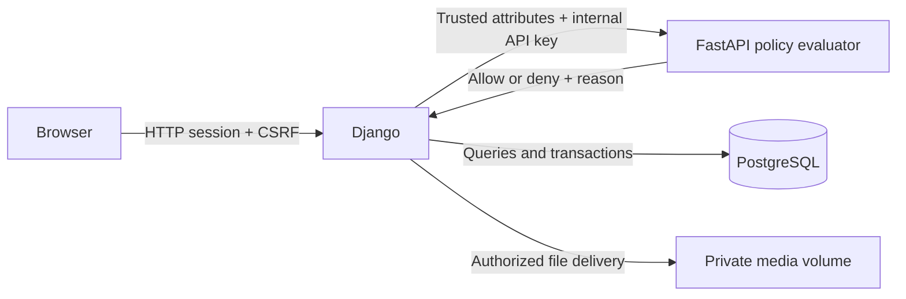

# Architecture and implementation notes

Access Granted has three permanent services: a Django web application, a stateless FastAPI policy service, and PostgreSQL. The browser reaches Django only. All content is English; stored timestamps use timezone-aware datetimes and display using Europe/Bucharest.



## Request and trust boundaries

1. Django authenticates the session and loads the current user.
2. The view resolves the target resource and organization. List queries and form choices are organization-scoped.
3. Django constructs subject, resource and enrollment attributes from database state. Browser fields never define the authoritative role, tenant or owner.
4. The evaluator applies active-account, tenant, role and action-specific attribute checks.
5. Django records the decision and enforces it before returning protected content or changing domain state.
6. Domain services also validate current business state and use transactions for occupancy changes.

The evaluator is the policy decision point; Django is the policy enforcement point and attribute source. An allow decision does not reserve a seat or guarantee satisfied prerequisites: those are checked by the transaction that performs enrollment.

No authorization decision cache is used. Role changes are effective for subsequent requests. There is no cross-service distributed transaction or claim of instantaneous revocation of a request already in flight.

## Data model

| Model | Main relationships and constraints |
|---|---|
| Organization | Unique slug; owns users and courses |
| User | One role and one organization; technical superuser may have no organization |
| Course | Organization, instructor, positive capacity, publication state; directed prerequisite relation |
| Material | Course, ordering, text or private PDF |
| Enrollment | One record per course/student; status, queue time and completion time |
| AuditEvent | Actor, organization, action, target, decision, reason, policy version and timestamp |
| DemoState | Unique initialization marker |

Prerequisites cannot refer to the course itself, another organization or a dependency cycle. An instructor must belong to the course's organization. Form and domain validation protect these rules in the application; arbitrary direct database writes are outside the application's API.

## Enrollment consistency

Enrollment, withdrawal, completion, archival and other occupancy-changing operations lock the same course row with `SELECT ... FOR UPDATE` inside an atomic PostgreSQL transaction. Under this convention, requests for one course serialize across Django workers. They then read the active enrollment count and perform the transition before releasing the lock.

The invariant is `count(ENROLLED for course) <= course.capacity`. A uniqueness constraint prevents multiple enrollment records for the same student/course. Re-enrollment reuses the cancelled record and updates its queue timestamp. Existing eligible waiters are considered before a new arrival occupies a newly free place.

The queue is ordered by entry time and primary key. A disabled, non-student, cross-organization or prerequisite-ineligible entry is skipped and stays waitlisted. Promotion is triggered by occupancy-changing application operations, not by a background scheduler. Completed enrollments free capacity and retain material access.

Archiving a course cancels its waitlist and closes new enrollment. Existing enrolled and completed students retain protected material access. This is a simplified self-paced course model, not a calendar or classroom timetable.

## Internal policy API

The service listens on container port 8001, without a published host port. `POST /authorize` and `GET /policies` require `X-API-Key`; `GET /health` is an anonymous liveness endpoint.

```json
{
  "subject": {"id": 12, "tenant_id": 1, "role": "STUDENT", "is_active": true},
  "action": "material_read",
  "resource": {"id": 3, "tenant_id": 1, "owner_id": 6, "state": "PUBLISHED", "kind": "course"},
  "context": {"enrollment_status": "ENROLLED", "has_participation": true}
}
```

```json
{
  "allowed": true,
  "reason": "ACCESS_GRANTED",
  "matched_rules": ["active_account", "tenant_isolation", "role_permissions", "material_membership"],
  "policy_version": "1.0.0"
}
```

Organization-level actions use `resource.kind: "organization"` and the organization's `tenant_id`; course actions use `resource.kind: "course"`. `GET /policies` returns the version, rule descriptions and role/action catalog. See the [service contract](../policy_service/README.md) for request validation and supported actions. The policy engine is explicit Python code, not a general rule language or XACML implementation.

## Failures, files and operations

- Policy HTTP errors, malformed decisions or a two-second timeout fail closed. Django returns a temporary-unavailability page and does not perform the requested protected mutation.
- A cross-organization detail request does not reveal the other organization's resource. Same-organization permission denials return a denied page.
- Private PDFs are read through authorized Django views. WhiteNoise serves static assets only; there is no public private-media route.
- Access and change events belong to the acting user's organization. Logs do not include passwords or complete document contents. Audit records are database records, not a tamper-proof external ledger.
- Docker health checks coordinate startup. `start.sh` creates secrets once, builds images and waits for readiness. Named volumes preserve PostgreSQL and media state.
- Django tests live in the root `tests/` directory; policy tests live in `policy_service/tests/`. Test databases are separate from demo data. The concurrency test must run against PostgreSQL, not SQLite.

The distributed demonstration is the HTTP policy boundary and its failure behavior. PostgreSQL remains a single coordination point. This project does not implement database replication, consensus, highly available authorization or a cloud security certification.
