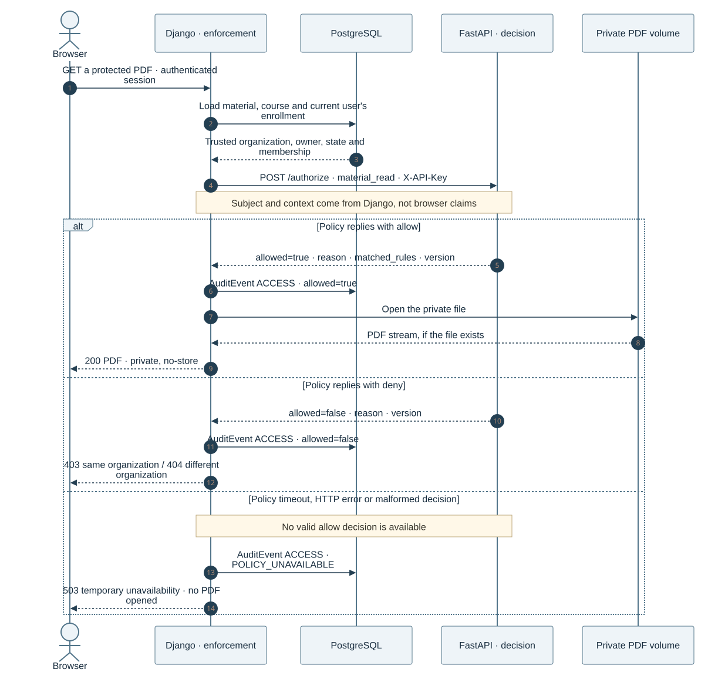
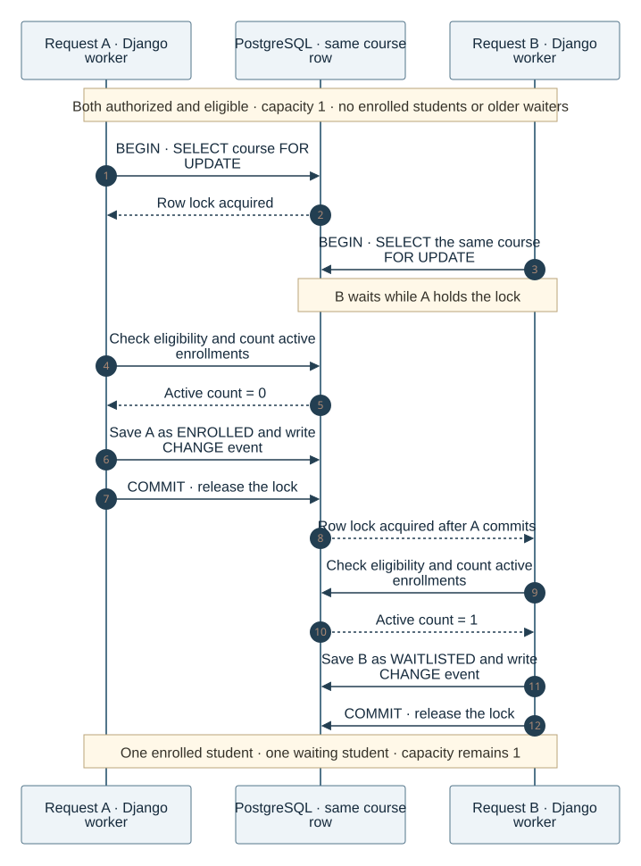

# How Access Granted works

Start here if you are joining the project. The diagrams describe the current implementation; follow the source links to find the code behind each flow. All images are included in the repository and can be opened locally in a browser.

| Question | Start with |
|---|---|
| What runs, and how do the services communicate? | [1. Architecture](#1-architecture) |
| What can each person do in the application? | [2. Roles and pages](#2-roles-and-pages) |
| How are courses, users and materials connected? | [3. Data model](#3-data-model) |
| What happens when someone opens a protected resource? | [4. Authorization and audit](#4-authorization-and-audit) |
| How do enrollment and waiting lists work? | [5. Enrollment states](#5-enrollment-states) |
| How is the last seat protected against simultaneous requests? | [6. Two requests for one seat](#6-two-requests-for-one-seat) |
| What changes when a course is published or archived? | [7. Course lifecycle](#7-course-lifecycle) |

For screen-by-screen instructions, use the [User guide](user-guide.md). For exact role permissions, use the [permission matrix](permissions.md).

## 1. Architecture



**Read it from the browser inward.** The browser sends requests to Django. Django provides the pages, authenticates users, loads attributes and enforces authorization. FastAPI evaluates policies; PostgreSQL stores application state. Files live in a separate private volume.

- Only the Django port is published on the host, bound to `127.0.0.1` (port 8000 by default).
- FastAPI receives the attributes supplied by Django over HTTP with an internal API key. It has no database connection or persistent policy-decision store.
- Django queries PostgreSQL directly. It also serves authorized PDF downloads; the browser cannot fetch a PDF directly from the volume.
- Database and PDF volumes survive ordinary restarts. Static CSS, JavaScript and icons are part of the web image, not the private PDF volume.

The separate policy service makes authorization a distributed HTTP interaction. Enrollment consistency is coordinated by one PostgreSQL database. There is no cross-service transaction or replicated database in this version.

**Source:** [compose.yaml](../compose.yaml), [Django settings](../config/settings.py), [policy endpoints](../policy_service/app/main.py). [Editable diagram](diagrams/01-architecture.mmd).

## 2. Roles and pages



**Choose a role, then follow its branch.** Shared page names do not mean that everyone sees the same records. The catalog and dashboard are scoped to the current organization; course visibility also depends on publication state, ownership and participation.

| Role | Example in the demo | Scope of work |
|---|---|---|
| Student | `atlas.student1` | Own enrollment, course progress and authorized materials |
| Instructor | `atlas.instructor` | Assigned courses, materials, participants and completion |
| Organization Administrator | `atlas.admin` | Courses, users, policies and audit records in Atlas University |
| Technical superadministrator | `superadmin` | Organizations and technical administration through Django Admin |

An organization administrator cannot manage Nova Academy by changing a URL or a form field. An instructor cannot manage another instructor's course simply because both work in Atlas. Buttons guide navigation; the server repeats authorization for direct requests.

**Source:** [views](../learning/views.py), [role/action catalog](../policy_service/app/policies.py), [User guide](user-guide.md). [Editable diagram](diagrams/02-navigation.mmd).

## 3. Data model



**Start with Organization, then follow Course.** A course belongs to an organization and has an assigned instructor. It contains materials and enrollment records. An enrollment joins one student to one course. The diagram shows selected fields, not every Django field or framework table.

- `||` means exactly one, `o|` means zero or one, and `o{` means zero or many. Ordinary organization accounts must have an organization; the nullable user relationship also accommodates the technical superuser.
- A material inherits its organization and owner through its course. There is no separate tenant field on `Material` or `Enrollment`.
- `(course_id, student_id)` is unique. Re-enrollment reuses the cancelled row instead of creating another row for the same pair.
- Prerequisites form a **directed** many-to-many relation stored by Django in a join table. If Distributed Systems Lab requires Python Foundations, the reverse dependency is not implied. Self-dependencies, cross-organization dependencies and cycles are rejected by application validation.
- Audit targets are recorded as `resource_type` and `resource_id`, not foreign keys to every resource type. `actor_name` preserves the username if the optional actor link later becomes null. Audit events are scoped to the acting user's organization.

The separate `DemoState` model stores a unique initialization key and timestamp. It is omitted from the learning-resource diagram because it controls repeatable demo seeding, not course access.

**Source:** [models](../learning/models.py), [form validation](../learning/forms.py), [prerequisite validation](../learning/services.py), [demo data](../data/README.md). [Editable diagram](diagrams/03-data-model.mmd).

## 4. Authorization and audit



**Follow one request from top to bottom.** This example starts after successful session authentication, with an existing PDF material. Django resolves the material's course and builds the authorization payload using current database values. The action is `material_read`; the policy resource is the **course that owns the material**. Text lessons use the same permission check.

RBAC asks whether the role permits the action. ABAC checks the account, organization and relevant course attributes. For a student reading materials, the course must be published or archived and the enrollment must be `ENROLLED` or `COMPLETED`. An instructor needs ownership; an administrator remains bounded by the organization.

| Policy outcome | What Django does |
|---|---|
| Allow | Writes an `ACCESS` event, then opens the protected file |
| Deny | Writes an `ACCESS` event and returns 403; a cross-organization resource denial returns 404 |
| Timeout, HTTP error or malformed decision | Records `POLICY_UNAVAILABLE` and returns 503 without opening the file or performing the protected mutation |

The diagram assumes the database is available. Failure to persist a required audit event also interrupts the request. An allow event records an **authorization decision**, not proof that a download or mutation succeeded: an allowed PDF request can still return 404 if the file is missing.

For changes, read the events together:

- `ACCESS`: the authorization decision, reason and policy version.
- `CHANGE`: a completed application change, such as `enrollment_created`, `enrollment_completed` or `waitlist_promoted`.
- `WORKFLOW`: a workflow refusal recorded by the enrollment view, such as `ELIGIBILITY_NOT_MET` after an authorization allow.

The audit log is an organization-scoped database record. It is not a tamper-proof external ledger, and this version has no request correlation ID. Compare actor, action, resource and timestamp when following a scenario. Auth failures and missing resource IDs can terminate before the policy call; not every HTTP error produces an authorization event.

**Source:** [authorization client and audit helper](../learning/authorization.py), [download/enrollment views](../learning/views.py), [policy evaluator](../policy_service/app/policies.py), [503 middleware](../learning/middleware.py). [Editable diagram](diagrams/04-authorization.mmd).

## 5. Enrollment states



**The four uppercase names are stored enrollment states.** The admission diamond is a decision inside the transaction, not another database status. It assumes an authorized, active student in the correct organization, a published course and completed prerequisites. Failed eligibility checks do not create an enrollment.

| State | Counts against capacity? | Student can read materials? |
|---|---|---|
| `ENROLLED` | Yes | Yes, while the course is published or archived |
| `WAITLISTED` | No | No |
| `COMPLETED` | No | Yes, while the course is published or archived |
| `CANCELLED` | No | No |

When a seat becomes free, the application scans waiters by `queue_entered_at`, then primary key. It rechecks the account, Student role, organization and completed prerequisites. The first eligible waiter is promoted; skipped entries remain waitlisted. Existing eligible waiters have priority over a new arrival.

Withdrawal and completion trigger promotion. Course edits and new enrollment requests also check for places that can be offered to the queue. There is no background promotion timer: changing a student's eligibility alone does not immediately run the queue. An archived course never promotes waiters.

Reapplying after cancellation assigns a new queue timestamp. Repeating an otherwise valid enrollment request for an existing non-cancelled enrollment returns that record. Completion has no reversal operation in the application.

**Source:** [enrollment services](../learning/services.py), [enrollment tests](../tests/test_enrollments.py). [Editable diagram](diagrams/05-enrollment-states.mmd).

## 6. Two requests for one seat



**Watch when request B acquires the lock.** Two different students request the same published course with one available seat and no older waiters. Both have already passed authorization. Each transaction locks the same `Course` row before reading occupancy or changing enrollment.

Request B cannot finish acquiring that row lock until A commits. It then sees A's committed enrollment and joins the waitlist. The schedule shown is an example; B could win the lock instead. The invariant is the same:

```text
active ENROLLED records for a course <= course.capacity
```

Withdrawal, completion, archival and capacity changes follow the same course-locking convention. The unique `(course, student)` constraint separately prevents duplicate enrollment records. The row lock is held by PostgreSQL, so it works across Django workers rather than only inside one Python process.

The policy service does not reserve seats. An allow decision is followed by fresh business checks inside the transaction. These guarantees depend on application code following the locking convention; arbitrary database writes are not covered by it.

**Source:** [`enroll_student` and related services](../learning/services.py), [course editing](../learning/views.py), [PostgreSQL concurrency test](../tests/test_enrollments.py). [Editable diagram](diagrams/06-last-seat.mmd).

## 7. Course lifecycle



**Course state and enrollment state are different.** Publishing opens a course to new enrollment. Archiving closes enrollment and preserves existing participation history; it does not mark enrolled students as completed.

- A manager may create either a draft or a published course.
- Returning a published course to draft is rejected if any enrollment is not `CANCELLED`. A waiting or completed record also blocks that change.
- The explicit Archive action cancels waiting entries. Existing `ENROLLED` and `COMPLETED` records keep their state and material access.
- Archived course details and materials are read-only in management forms. The application has no unarchive action. An authorized manager can still record completion for an existing enrolled participant.

**Source:** [course form](../learning/forms.py), [`archive_course`](../learning/services.py), [management views](../learning/views.py). [Editable diagram](diagrams/07-course-lifecycle.mmd).

## Use the diagrams in a team discussion

Start the application with `bash scripts/start.sh`. The [eight-minute demo](demo.md) provides the account setup and the full walkthrough. These pairs connect the diagrams to observations:

| Scenario | Diagram to explain it | What to check |
|---|---|---|
| Nova administrator opens an Atlas course URL | Roles + authorization | 404 without the protected course content |
| Waitlisted student requests a PDF, then is promoted | Authorization + enrollment states | Denial first, successful download after promotion |
| One student withdraws from a full course | Enrollment states | Eligible waiter becomes `ENROLLED` |
| Two requests compete for the last seat | Last-seat sequence | Run the automated concurrency test; manual clicks do not establish simultaneity |
| Policy container is stopped | Architecture + authorization | Protected requests return 503; retry after restoring the service |
| A course with a waiting list is archived | Course lifecycle | Queue cancelled; existing enrolled/completed access retained |

To edit or regenerate the images, see [the diagram sources and rendering instructions](diagrams/README.md).
